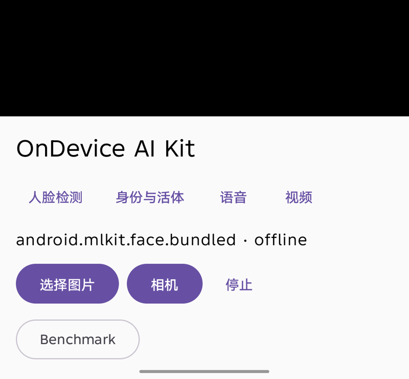
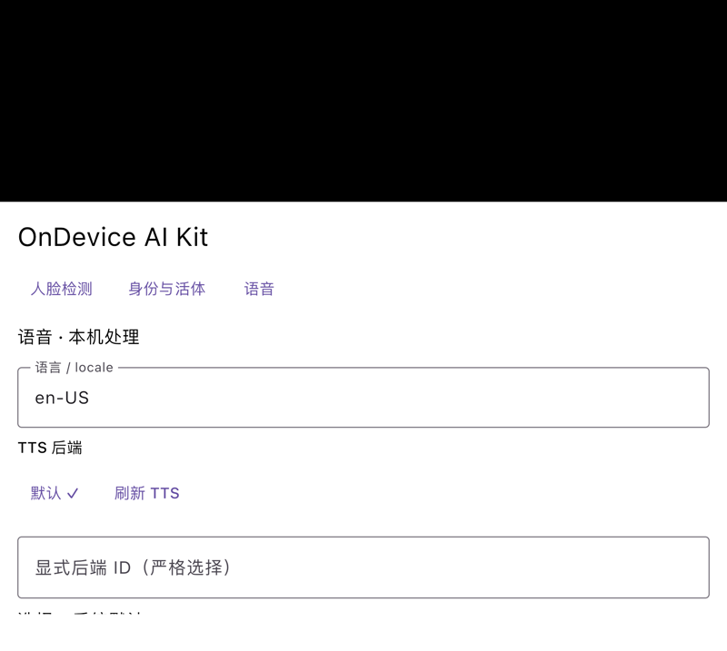
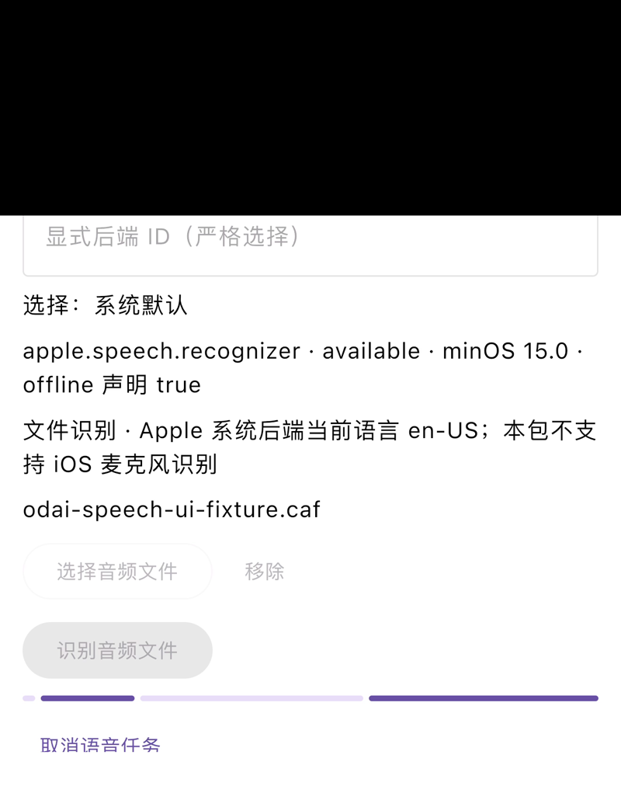
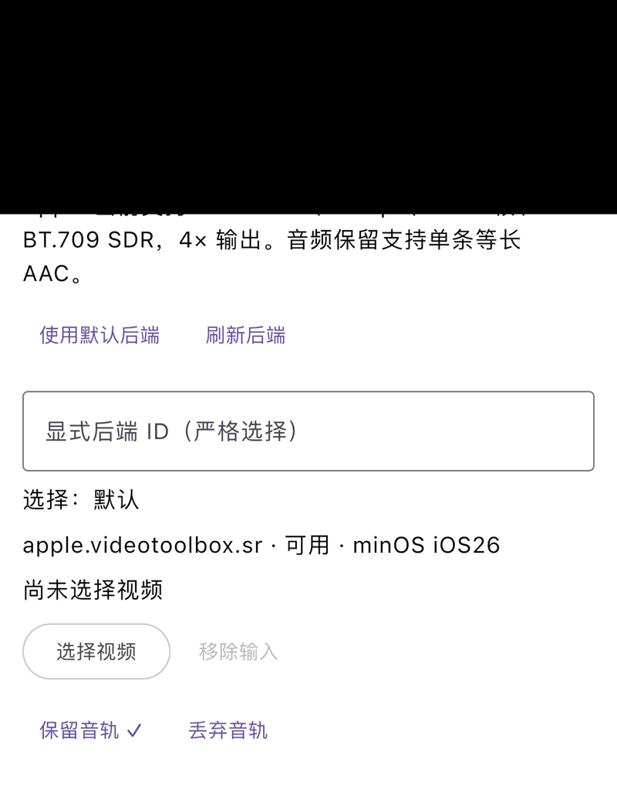

# OnDevice AI Kit：双端端侧 AI 能力介绍

> 面向项目负责人、产品和架构评审。更新于 2026-10-30。当前基点：feat/sdk-foundation。
>
> 本页介绍项目价值、方案、Demo 和已测数据。阶段性验证不等于正式发布验收；当前状态为 open/not-ready。

## 0. 摘要

OnDevice AI Kit 为 iOS 与 Android 提供可复用的端侧 AI SDK、KMP 公共契约和 Demo 宿主。业务 App 负责权限、选片、下载、输入编排、预览与分享；SDK 负责对已可读的本地输入执行能力预检、显式后端选择、任务进度、结果、取消、关闭和输出文件生命周期。

项目目标是让人脸、语音、视频和多模态能力在两端按同一任务语义接入，同时保留各平台真实后端和模型资产的差异。Demo 是能力展示和验证工作台；正式 App 可以只依赖需要的 backend。基础路线图已达到 10/12 个阶段停止点，P4 原生资源闭环和 P11 统一质量/资源验收仍开放。

## 1. 背景与适用场景

端侧 AI 可用于离线或弱网场景、要求低交互延迟的页面，以及希望把原始图像、音频和视频留在设备本地的业务。直接把平台 API 写进业务页面，会使权限、模型、线程、取消、输出清理和验证口径分散。项目用统一任务模型把这些问题收束到 SDK，保留平台后端的独立实现。

典型链路包括：照片或相机的人脸检测；文本朗读与本地音频转写；固定规格视频超分与沙盒导出；Apple 设备上的图像/短视频语义生成；以及身份与活体的受控接入契约。生产模型、授权数据和完整质量门槛尚未具备的能力，Demo 会显示 unavailable 或 unverified。

## 2. 业务数据流与分工

本地文件、系统 Files、相机或麦克风 → 宿主权限和输入编排 → 模型/资源准备 → SDK capability preflight 与 request → iOS 或 Android 实际 backend → progress/result/cancel/close → output lease → 宿主预览、入库或分享。原始 JSON、输入哈希和设备身份进入 readiness 与 benchmark 工具。

| 层级 | 责任 |
| --- | --- |
| Common contract / KMP bridge | request、capability、progress、result、错误、取消、关闭、lease |
| iOS native products | Core、ModelStore、Face、Speech、Video、Multimodal，以及 Vision、Speech、VideoToolbox、MLXVLM backend |
| Android native modules | sdk-core、model-store、face、speech、video、multimodal，以及 ML Kit、系统语音和可选 LiteRT-LM backend |
| Host / Demo | 权限、系统 picker、相机/录音、输入 staging、页面状态、预览和分享 |
| Evidence tools | 原始逐 run JSON、来源哈希、分组统计和发布状态矩阵 |

后端选择有两个决定：运行时选择当前已注册且兼容的 backend；构建时决定正式包携带哪些模块、模型和原生依赖。选中后端失败时返回明确错误，不静默切换路线。输出文件保存在 App 沙盒，由宿主决定是否复制到媒体库或分享；Demo 的合成素材不需要写入相册。

## 3. 当前支持能力

| 能力 | iOS | Android | 当前边界 |
| --- | --- | --- | --- |
| 人脸检测 | Vision 真机、SDK/consumer、benchmark | ML Kit 真机、Maven consumer | 现代设备有界通过；最低系统和峰值资源未闭合 |
| TTS | Apple Speech 真机 5/5 | 系统 TTS 基础链路 | 自然音质、完整离线矩阵未闭合 |
| 文件 ASR | 系统 picker、on-device 识别、生产 SDK consumer 5/5 | 缺资源时明确 MISSING_ASSETS | Android 真实识别资源待具备 |
| 麦克风 ASR | capture、bridge、Demo 状态契约 | 权限和模块边界 | 真实录音终态及自然 CER/WER 待测 |
| Video SR | VideoToolbox 4x、48 帧、取消与同进程重入 | 生产后端待验证 | iOS 质量裁定仍 unverified |
| Apple MLXVLM | 单图/视频、真实 Files、取消和前后台重入 | 不适用 | temporal exact-label 仍为 observed-failure |
| Android LiteRT-LM | 不适用 | contract、ModelStore 与明确 unavailable | 授权权重、production factory、native drain 缺失 |
| Identity / PAD | 契约、加密存储、1:1/1:N、活体会话 | bridge、Demo、consumer | 生产模型、PAD 和校准数据缺失 |

## 4. Demo：从界面理解能力

以下截图只展示真实 Demo 的操作面；截图本身不代替原始测试报告。Android 截图来自 TECNO KM9 / Android 15 真机；iOS 截图来自项目已有的模拟器或真机 UI 验证附件，逐图注明。

### Android：统一入口、人脸后端和操作按钮

Android Demo 同页提供人脸检测、身份与活体、语音、视频入口。截图中的 android.mlkit.face.bundled · offline 是当前人脸 backend；选择图片、相机、停止和 Benchmark 属于宿主交互。黑色区域是未启动相机时的预览占位，不是推理结果。

### iOS：语音页面和后端选择

iOS 模拟器截图展示语言、TTS backend、显式 backend ID 和朗读文本输入。宿主先查看可用性，再提交任务；不同 backend 的实际状态和失败原因在界面可见。

### iOS：文件 ASR 的系统权限边界

iOS 真机 UI 验证截图展示系统语音识别权限提示和本地音频文件选择区域。权限与文件输入由宿主处理；SDK 返回实际识别 backend、任务终态和结果。

### iOS：Video SR 的输入和输出意图

iOS 真机 UI 验证截图展示 VideoToolbox SR backend、4x 输出、选择视频，以及保留或丢弃音轨的选项。Demo 完成后可预览、分享或清理沙盒输出。截图处于尚未选择视频的状态；处理成功由 48 帧报告和结构校验支撑。

## 5. 性能与效果对比

下表只展示已有原始报告可支撑的测量。各行设备、素材、任务时段不同，不能合成一个双端性能排名。

| 能力与设备 | 实际 backend | 测量结果 | 解释边界 |
| --- | --- | --- | --- |
| 人脸，iPhone17,2 / iOS 27.0.1 | apple.vision.face | inference p50/p95 = 2.432 / 3.065 ms，30 次 | 与 Android 的 fixture 不同；质量和峰值资源未测 |
| 人脸，TECNO KM9 / Android 15 | android.mlkit.face.bundled | inference p50/p95 = 10.854 / 18.088 ms，30 次 | 与 iOS 不是同一输入；不能作芯片排名 |
| Apple MLXVLM，iPhone17,2 / iOS 27.0.1 | mlx.smolvlm2-500m | total p50/p95 = 940.974 / 971.115 ms，30 次 | 固定合成红方块 rubric 30/30；采样 RSS 增量约 1.152 GB；自然质量待测 |
| 文件 ASR，iPhone 16 Pro Max / iOS 27.0.1 | apple.speech.recognizer | 生产 SDK 路径 5/5，p50/p95 = 76.484 / 93.436 ms | 固定合成 CAF；采样 RSS 约 36.8–36.9 MB；不代表自然语音 CER/WER |
| TTS，iPhone 16 Pro Max / iOS 27.0.1 | Apple Speech | 固定短句 5/5，p50/p95 = 2779.727 / 2779.792 ms | 采样 RSS 约 44.8 MB；不代表自然音质 |
| Video SR，iPhone 16 Pro Max / iOS 27.0.1 | VideoToolbox SR | 48 帧，1280×720；每帧 p50/p95 = 93.408 / 94.587 ms | 采样 RSS 增量 127.5 MB；PSNR/SSIM = 36.776212 / 0.979250，质量裁定 unverified |
| 同素材双三次基线，iPhone 16 Pro Max | Core Image bicubic | 每帧 p50/p95 = 1.467 / 2.114 ms | PSNR/SSIM = 38.872866 / 0.983506；与 SR 同次实验，但先后顺序和模型目标不同 |

Video SR 对照使用一条固定自然短视频、相同输入与色彩/编码实验约定。双三次速度和 PSNR/SSIM 在这条素材上更高；这不构成跨场景的模型质量结论。所有 RSS 均为进程离散采样，不是 GPU 内存、全机峰值或能耗。P11 仍需自然质量、持续资源和统一测量口径。

## 6. 当前交付状态与下一步

已形成双端公共契约、native SDK、Demo 和证据工具；现代设备上有多项相机、picker、语音、视频和 Apple 多模态生命周期证据。基础路线图为 10/12，项目已用 F01–F12 专项 milestone/issue 在 GitHub 与 GitLab 对齐追踪。

正式发布仍为 open/not-ready，主要缺口是 P4 原生资源归属/释放、P11 统一质量和峰值资源、最低系统 iOS 15 / Android API 26 真机、Android LiteRT-LM 授权模型与 native drain、Identity/PAD 生产模型和校准、Apple MLX 增强二进制分发，以及最终复审。设备或授权素材未到位的专项继续标为 deferred/unverified。

下一阶段先收口不依赖低系统设备的 F04/F08/F11 数据和生命周期，再推进 F09 分发设计与 P4 资源专项。所有专项退出标准完成后，才执行候选冻结、统一复审和发布裁定。

## 7. 证据入口

- [2026 年 10 月项目月报](2026-10-project-monthly-report.md)
- [P11 分组 benchmark](../validation/p11-grouped-benchmark.md)
- [Video SR 后端和真机数据](../validation/video-sr-backends.md)
- [语音 Demo 与 bridge](../validation/speech-demo-bridge.md)
- [Apple MLXVLM 视频 Demo](../validation/multimodal-video-demo.md)
- [F01–F12 专项跟踪](../validation/foundation-tracking.md)

文档结构参考用户提供的《音视频本地处理方案选型调研报告》：摘要、业务数据流、双端证据、SDK 分层、能力对照、风险和后续计划。
